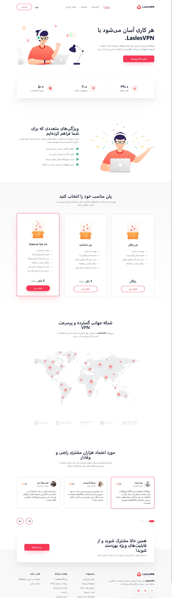

# LaslesVPN Landing Page

یک لندینگ پیج مدرن، زیبا و کاملاً واکنش‌گرا (Responsive) با تطابق حداکثری بر اساس طراحی فیگمای **LaslesVPN**.

## ویژگی‌های پیاده‌سازی شده

- ⚡ **توسعه داده شده با React + Vite + Tailwind CSS:** سریع، سبک، مدرن و بدون نیاز به بک‌اند (Pure Frontend SPA).
- 📱 **کاملاً واکنش‌گرا (Responsive):** نمایش بی‌نقص در تمامی نمایشگرهای دسکتاپ، تبلت و موبایل همراه با منوی همبرگری موبایل.
- 🎠 **اسلایدر نظرات مشتریان:** اسلایدر تعاملی با دکمه‌های ناوبری قبلی/بعدی و ایندیکیتورهای متحرک.
- 📦 **انتخاب پلن‌های قیمتی:** امکان انتخاب و فعال‌سازی هر یک از پلن‌های کاربری به صورت تعاملی.
- 🚀 **بیلد تمیز و بدون ارور:** تست‌شده با بیلد کامل پروداکشن بدون هیچ‌گونه خطا یا هشدار.

---

## نحوه اجرا

### ۱. نصب وابستگی‌ها
```bash
npm install
```

### ۲. اجرای محیط توسعه (Dev Server)
```bash
npm run dev
```
سپس آدرس `http://localhost:3000` را در مرورگر باز کنید.

### ۳. ساخت نسخه پروداکشن (Build)
```bash
npm run build
```

### ۴. پیش‌نمایش نسخه پروداکشن (Preview)
```bash
npm run preview
```

